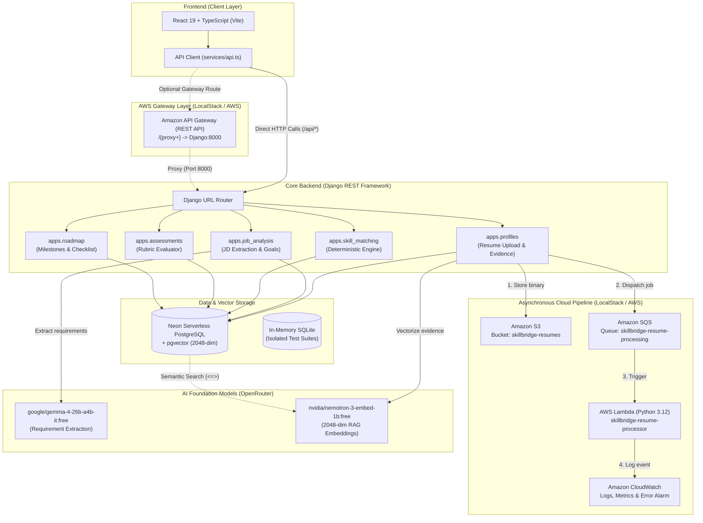
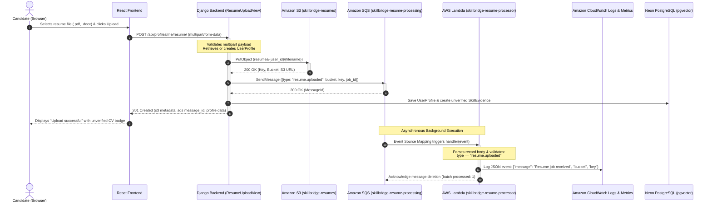

# SkillBridge AI — Architecture & Integration Workflow

This document details the system architecture, component responsibilities, cloud services integration, data flows, and team extension conventions for SkillBridge AI.

---

## 1. System Architecture Diagram



---

## 2. Component Responsibilities & Ownership Boundaries

| Component | Technology | Primary Responsibilities | Team Ownership |
| :--- | :--- | :--- | :--- |
| **Frontend** | React 19, TypeScript, Vite, Tailwind CSS v4, Lucide Icons | Candidate dashboard, evidence portfolio review, job posting upload, skill gap matrix visualization, practical assessment testing, and milestone tracking. | Frontend Engineer(s) |
| **Backend API** | Python, Django 5.x / 6.0, Django REST Framework | REST endpoints, request validation, business rules, database ORM transactions, and file upload processing. | Backend Engineer(s) |
| **Database & Vector DB** | Neon PostgreSQL (18.6) + `pgvector` (0.8.6) | Relational persistence for profiles, jobs, requirements, match reports, and 2048-dim vector embeddings for semantic skill matching. | Backend / Data Engineer |
| **AWS Service Layer** | `boto3`, `backend/services/aws_service.py` | Graceful abstraction for S3 object uploads and SQS message dispatching with automatic self-healing and offline fallbacks. | Cloud / Backend Engineer |
| **Cloud Storage** | Amazon S3 (`skillbridge-resumes`) | Durable object storage for raw learner CV/resume documents (`resumes/{user_id}/{filename}`). | Cloud Infrastructure |
| **Message Queue** | Amazon SQS (`skillbridge-resume-processing`) | Asynchronous buffer decoupling resume uploads from downstream document parsing and AI vectorization. | Cloud Infrastructure |
| **Serverless Processing** | AWS Lambda (`skillbridge-resume-processor`) | Background event consumer triggered automatically by SQS messages to validate and process resumes. | Cloud / Backend Engineer |
| **Observability** | Amazon CloudWatch | Captures Lambda invocation logs, execution error metrics, and triggers alerts on failure via `skillbridge-resume-processor-errors`. | Cloud Infrastructure |
| **AI Services** | OpenRouter (Gemma 4 & Nemotron 3) | Text generation for requirement extraction and vector embeddings generation with deterministic rule engine fallbacks. | AI / Backend Engineer |

---

## 3. End-to-End Resume-Upload Workflow

The resume upload workflow demonstrates the complete end-to-end integration between the React frontend, Django backend, Amazon S3, Amazon SQS, AWS Lambda, and CloudWatch:



### Detailed Workflow Stages:
1. **Frontend Dispatch**: The React application sends a `multipart/form-data` request containing the resume binary under the form field name `file`.
2. **Django Validation & S3 Ingestion**: `ResumeUploadView` verifies the file stream and passes it to `resume_pipeline.upload_resume()`. Boto3 uploads the file to `s3://skillbridge-resumes/resumes/{user_id}/{clean_filename}`.
3. **Queue Notification**: Upon S3 confirmation, Django constructs a structured `resume.uploaded` JSON payload and dispatches it to SQS.
4. **Database State Recording**: Django creates or updates a `SkillEvidence` record tagged with review status `unverified` and points the evidence reference to the S3 URL.
5. **Immediate Client Response**: Django returns HTTP `201 Created` immediately with S3 and SQS metadata, avoiding holding the browser connection open for long-running document parsing.
6. **Lambda Processing & CloudWatch Logging**: LocalStack / AWS automatically triggers the `skillbridge-resume-processor` Lambda function via SQS event source mapping. The handler validates the payload and logs the execution output in CloudWatch.

---

## 4. Role of Amazon API Gateway

- **Configuration**: An API Gateway REST API named `SkillBridge Django API` is configured in LocalStack at stage `dev`.
- **Routing**: The gateway resource `/{proxy+}` with method `ANY` proxies all incoming HTTP requests to Django at `http://host.docker.internal:8000/{proxy}` using `HTTP_PROXY` integration.
- **Current Client Flow**: In the current local development setup, the React frontend interacts **directly** with Django at `http://127.0.0.1:8000/api` (configured via `VITE_API_BASE_URL` in `frontend/.env`).
- **Production / Gateway Flow**: The API Gateway route enables testing cloud-native deployments and simulating serverless ingress without modifying the Django URL routing schema.

---

## 5. Developer Guide: How to Extend the Codebase

### How to Add a New Django Endpoint
1. **Model / Migration** (if required): Define models in `backend/apps/<feature>/models.py`. Generate and apply migrations:
   ```powershell
   python backend/manage.py makemigrations <feature>
   python backend/manage.py migrate
   ```
2. **Serializer**: Add a serializer in `backend/apps/<feature>/serializers.py`.
3. **View**: Implement an APIView in `backend/apps/<feature>/views.py`. Ensure error handling returns consistent JSON objects (`{"error": "..."}`).
4. **URL Configuration**: Register the route in `backend/apps/<feature>/urls.py`. Verify that the top-level include in `backend/skillbridge_backend/urls.py` correctly maps to your route.
5. **Unit Tests**: Add test cases in `backend/apps/<feature>/test_<feature>.py`. Verify using `python -m pytest`.

### How to Introduce a New SQS Message Type
1. Define the message payload schema in `backend/services/aws_service.py`:
   ```python
   payload = {
       "type": "assessment.completed",
       "user_id": user_id,
       "task_id": task_id,
       "score": score
   }
   ```
2. Update the Lambda handler in `lambda/resume_processor/handler.py` to route on `job.get("type")`:
   ```python
   if job.get("type") == "assessment.completed":
       # Handle assessment event
       ...
   ```
3. Re-package the Lambda zip file in LocalStack:
   ```powershell
   docker exec skillbridge-localstack bash /etc/localstack/init/ready.d/01-init-aws.sh
   ```

### How to Add a Frontend API Integration
1. Define the TypeScript interfaces in [frontend/src/types/index.ts](file:///d:/Skill%20bridge%20AI/Skill-bridge-AI/frontend/src/types/index.ts).
2. Add a typed API client method in [frontend/src/services/api.ts](file:///d:/Skill%20bridge%20AI/Skill-bridge-AI/frontend/src/services/api.ts):
   ```typescript
   export const api = {
     // ...
     getMyFeature: (id: string): Promise<MyFeatureResponse> =>
       apiFetch<MyFeatureResponse>(`/my-feature/${id}/`),
   };
   ```
3. Consume the API method in your React component with appropriate loading, error, and success states.
4. Add component unit tests in `frontend/src/test/`.
